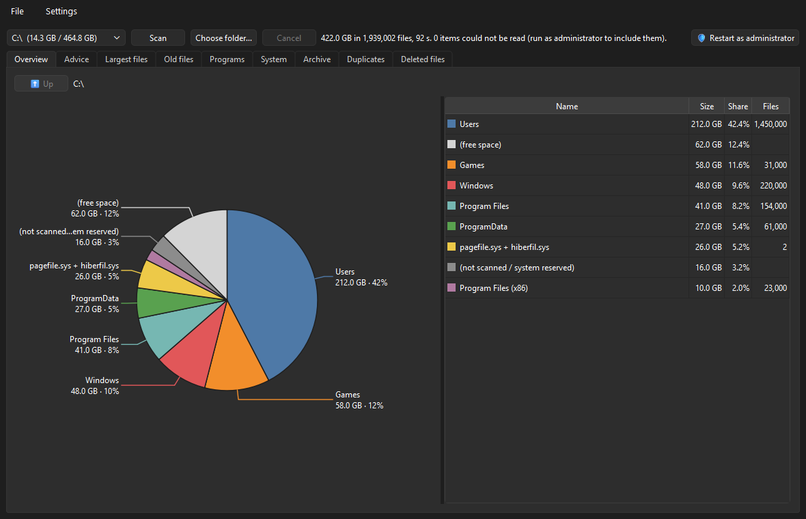

# DiskDiet

Portable Windows tool that shows where your disk space went and tells you, with reasons,
what is safe to remove. One `.exe`, no installation, no telemetry.



Interface in English and Italian (follows the Windows language).

## What it does

- **Overview** — labelled pie chart of the drive; click a slice to go into a folder,
  right-click to open it in Explorer or send it to the Recycle Bin.
- **Advice** — known space hogs (temporary files, browser caches, pip/uv/npm caches, IDE
  leftovers, Docker, Android emulators, AI models…) each with its size, a safety level and
  an explanation. Safe items are cleaned with one click; the others get a **guided
  check** that asks about each item and then deletes what you chose.
- **Largest files** and **Old files** — by modification date (Windows refreshes the access
  date too often for it to mean anything).
- **Programs** — installed software by size, with an Uninstall button.
- **System** — hibernation file, page file, WinSxS, Windows Update leftovers, restore
  points: what each is, with buttons that run the official commands in a built-in
  terminal. Guided compaction of Docker/WSL virtual disks.
- **Archive** — big videos, virtual machines, old installers, archives already extracted:
  candidates for another drive. The guided check can move them there (copy, verify,
  then remove the original).
- **Duplicates** — identical files found by content, hashed in parallel.
- **Deleted files** — a log of everything DiskDiet removed or moved, with Restore.
- **Settings** — theme, language, thresholds, update check.
- Progress bar at the bottom for scans, duplicate search and clean-ups.
- **Report** — export as JSON or HTML.

## Safety

| Level | What DiskDiet does |
|---|---|
| Safe | Empties the folder after you tick it and confirm. Goes to the Recycle Bin, except temporary files, which are deleted permanently (the confirmation says so). |
| Check first | Guided check: one question per item (delete / keep), one confirmation at the end. Deleted items go to the Recycle Bin. |
| System | Offers the official commands as buttons. A command runs only when you click it, is shown in full, and asks for confirmation if it changes the system. |
| Archive | Guided check with a third choice: move to another drive. |

- Nothing is removed without a preview and an explicit confirmation.
- Everything removed is logged and, unless it was a temporary file, can be restored from
  the **Deleted files** tab. On exit DiskDiet tells you how much is waiting in the
  Recycle Bin: that space is free only once the bin is emptied.
- Files in use are skipped, never forced.
- Before a command that changes Windows itself (hibernation, component clean-up) DiskDiet
  offers to create a **restore point**. It covers system files and the registry, not your
  own files: for those the safety net is the Recycle Bin.
- `C:\Windows` (except `Temp`), `Program Files` and other users' profiles are never touched.
- Runs without administrator rights. A **Restart as administrator** button is there for
  what needs them: system commands (`powercfg`, `DISM`), reading every folder, protected
  leftovers. Compacting a virtual disk shows one UAC prompt on its own.
- Commands come only from the built-in catalogue and are started as argument lists,
  never through a shell. Values you type (a model name, a version) are restricted to
  plain names.
- **Network:** the only connection is the update check, an anonymous request to GitHub
  Releases. It can be turned off in Settings. An update is downloaded only when you
  press the button, and is installed only if its SHA-256 matches the published one.

## Download

Get `DiskDiet-<version>.exe` from the [Releases](../../releases) page and run it.

The exe is built by GitHub Actions from this repository. Until the project has a code
signing certificate, Windows SmartScreen may warn about an unknown publisher and some
antivirus products may flag it, as they often do with PyInstaller programs. You can check
that your download is the one built here:

```
gh attestation verify DiskDiet-<version>.exe --repo denilnicolosi/diskdiet
```

or compare its SHA-256 with the `.sha256` file attached to the release.

## Command line

```
DiskDiet.exe --report json --root C:\ --out report.json
```

Scans without opening a window and writes the same data the Report menu exports.

## Run from source

Requires [uv](https://docs.astral.sh/uv/).

```
uv sync
uv run python -m diskdiet
uv run pytest
```

Build the exe: `pwsh scripts/build.ps1` → `dist/DiskDiet.exe`.

Settings, the deletion log and `diskdiet.log` (operations and errors, useful when
reporting a bug) live in `%LOCALAPPDATA%\DiskDiet`; Settings → About has a button that
opens it. Nothing in it leaves your computer. Delete the folder to reset the program.

## Contributing

Most useful contribution: a new cleanup rule for a program you know. It is one entry in
[`src/diskdiet/rules.py`](src/diskdiet/rules.py); see [docs/RULES.md](docs/RULES.md).
Architecture in [docs/ARCHITECTURE.md](docs/ARCHITECTURE.md), process in
[CONTRIBUTING.md](CONTRIBUTING.md).

## License

[MIT](LICENSE)
